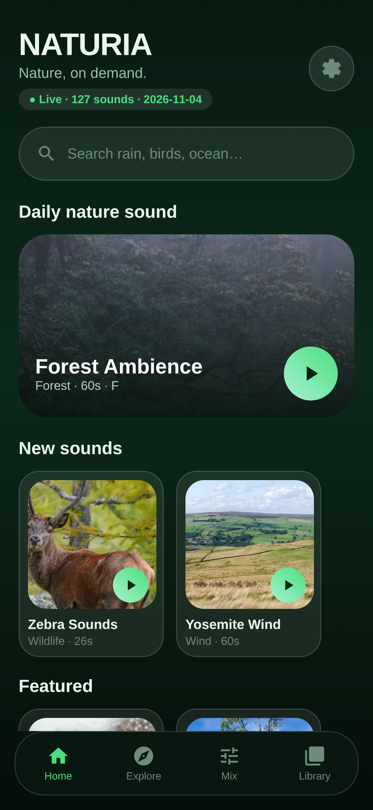
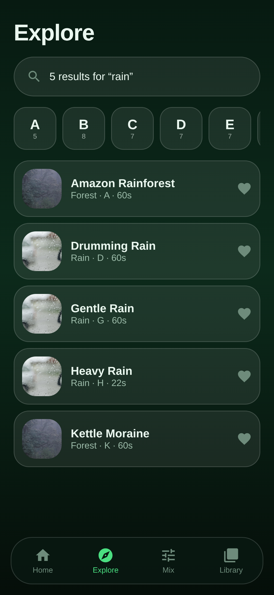
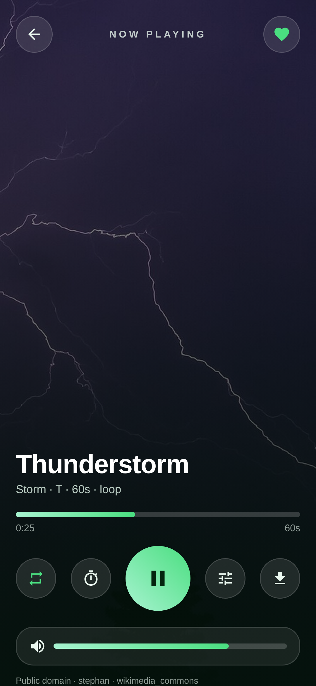
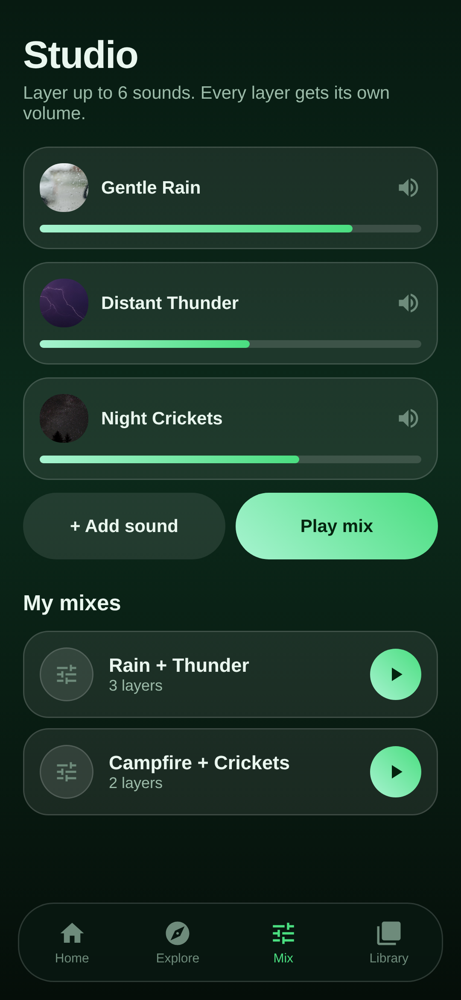
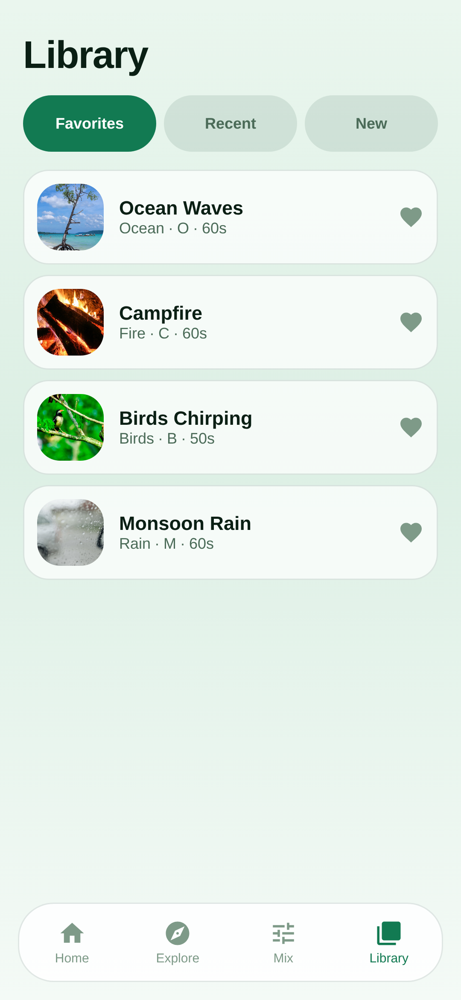

# NATURIA — Nature sounds, A to Z

A native Android nature-sound app that **streams online**: 127 licence-verified
recordings, a premium glass-and-forest interface, a multi-layer mixing studio and
a background media service with lock-screen controls. The catalogue is **live** —
new recordings added to the CDN show up in the app without an app update.

**[Download the APK](https://github.com/technicalnihilist-lgtm/NATURIA/releases/latest)** · 9.1 MB · `com.naturia.app` · Android 7.0+

[](https://github.com/technicalnihilist-lgtm/NATURIA/releases/latest)

| Explore | Player | Studio | Library (light) |
|---|---|---|---|
|  |  |  |  |

---

## What is inside

| | |
|---|---|
| Recordings | **127**, covering **all 26 letters A–Z**, 11 categories |
| Total audio | 82 MB of 96 kbps mono MP3, ~52 s per loop, loudness-levelled |
| Licences | Public domain 51 · CC BY-SA 41 · CC BY 25 · CC0 10 — **zero** unlicensed files |
| Sources | Wikimedia Commons 94 · Internet Archive 33 |
| APK | 9.1 MB, signed, `minSdk 24`, `targetSdk 34` |

### Features

**Discovery** — search across names, categories, tags and descriptions; A–Z index
with per-letter counts; featured, popular, recently-played rails; a deterministic
"daily nature sound" that is the same for everyone on a given day.

**Player** — full-screen artwork, transport, seek, per-sound volume, favourites,
hand-off into the mixer, a licence sheet with the original source link, and a
licence line under the controls showing creator, licence and provider. Every
sound **loops forever** by default (`REPEAT_MODE_ONE`) and the loop button turns
that on and off for real. Nothing is stored on the device.

**Sleep timer** — 5 / 10 / 15 / 30 / 60 minutes. The last eight seconds fade out
before playback stops, so it never cuts abruptly.

**Mixing studio** — layer up to six sounds, each with its own volume slider;
five one-tap presets (Rain + Thunder, Ocean + Seagulls, Forest + Birds,
River + Wind, Campfire + Night Crickets); save and replay your own mixes.

**Live catalogue** — the app ships a seed catalogue in assets, then pulls
`catalog/catalog.json` from the CDN on every start and swaps it in (cached to
internal storage, with a toast when new sounds arrive). Add a recording to the
CDN and it appears under *New sounds* on the next launch — no APK update.

**Library** — favourites, play history and a *New* tab, all in SQLite.

**Background playback** — a `MediaSessionService` with ExoPlayer: notification,
lock-screen controls, audio-focus handling, becoming-noisy handling, wake mode,
and no battery-hungry polling. In mix mode the layers are kept in step with
layer 0 every 400 ms so a lock-screen pause pauses the whole mix.

**Design** — deep forest green, soft blue and mint; translucent glass cards with
hairline strokes; 28 dp radii; CC-licensed nature photography as category art;
day/night themes (system, light, dark) with a proper light palette.

**Online only** — no download manager, no media stored on the phone, no storage
permission. If the network drops the player says so instead of failing silently.

**Privacy** — no account, no login, no analytics, no ads, no social features.
Permissions: `INTERNET`, `ACCESS_NETWORK_STATE`, `WAKE_LOCK`,
`FOREGROUND_SERVICE(+MEDIA_PLAYBACK)`, `POST_NOTIFICATIONS`. Nothing else.

---

## Audio catalogue and acquisition

Nothing in this app is a placeholder. Every file was found by the acquisition
pipeline in [`acquisition/`](acquisition/), licence-checked *before* download,
transcoded, hashed, and stored on our own CDN folder (`cdn/audio/`, served over
GitHub raw). The app streams from that folder and caches the same file locally
when you download.

```
discover ─► licence gate ─► subject filter ─► download ─► transcode ─► SHA-256 ─► catalogue
             (CC0/PD/BY/BY-SA)   (no music/speech)        96k mono 60s loop
```

* **Licence gate** — `CC0`, `Public Domain Mark`, `CC BY`, `CC BY-SA`, `GFDL` are
  accepted. `NC`, `ND`, `Sampling+`, "all rights reserved" and anything
  unparseable are rejected automatically. `ND` is rejected on purpose: we
  transcode every file, and transcoding is a derivative.
* **Subject filter** — the noisy part of open audio search. It rejects music
  (ragtime, waltzes, choir, "Op." numbers), spoken word (Wikipedia articles,
  court opinions, news, podcasts), game and film audio, and Xeno-canto bird
  files that were only matched because the description mentions wind.
* **Register** — `catalog/licenses.csv` and `catalog/ATTRIBUTION.md` carry
  creator, licence, licence URL, source page, original file URL and SHA-256 for
  every recording. The same data is in the app: every player shows the licence
  line, and *Settings → About & licences* lists all 127 entries with tappable
  source links.
* **Skipped slots** — 28 of the 155 search intents had no recording that passed
  both gates, so they were dropped rather than faked. They are recorded with
  their rejection reasons in `catalog/rejected.json`.

Provider status is documented in [`acquisition/README.md`](acquisition/README.md).
In short: Wikimedia Commons and Internet Archive are live and keyless; Freesound
and Pixabay adapters are wired but need API credentials (and Pixabay's public API
has no audio endpoint at all); Openverse needs a token and is not reachable from
this build environment. Because the licence gate sits in front of every provider,
enabling any of them later cannot let a non-permitted file into the build.

---

## Architecture

```
app/src/main/java/com/naturia/app/
├── model/      Sound, Mix, MixLayer
├── data/       CatalogRepository (assets/catalog.json + CDN URLs)
│               AppDb (SQLite: favourites, history, mixes, downloads)
│               DownloadStore (offline cache, progress, atomic .part → rename)
├── playback/   PlaybackHub (shared state) · PlaybackService (MediaSessionService,
│               ExoPlayer single + up to 6 mix players, sleep timer, notifications)
├── ui/         MainActivity · Home · Explore · Mix · Library fragments
│               PlayerActivity · SettingsActivity · AboutActivity · Adapters
└── util/       Art (asset artwork with LruCache)
```

* **Playback engine** — Media3 ExoPlayer, one instance for single playback and
  one per mix layer, all `REPEAT_MODE_ONE` for gapless looping.
* **State** — `PlaybackHub` is a small observable singleton in the same process,
  so the mini-player, player screen and service stay in sync without IPC.
* **Storage** — plain `SQLiteOpenHelper` (no Room, no annotation processing), so
  the build stays fast and the APK small.
* **Network** — `HttpURLConnection` only. No OkHttp, no image library; artwork is
  bundled and decoded from assets into an `LruCache`.
* **Delivery** — audio streams from jsDelivr (`cdn.jsdelivr.net/gh/...@main`), a
  real edge CDN, because `raw.githubusercontent.com` is throttled on many Indian
  networks. If a track fails to load, the player retries once against the GitHub
  raw mirror before showing an error, and a 30 s / 120 s load-control window
  keeps slow first reads from looking like dead tracks.
* **Live catalogue** — `CatalogRepository` parses the bundled seed synchronously,
  then refreshes from the CDN on a background thread and notifies the UI. The
  last good payload is cached in internal storage, so a cold start with no
  network still shows the full catalogue and streams as soon as it reconnects.
* **Failure handling** — a failed refresh keeps the previous catalogue and marks
  the header *Offline*; playback errors surface as a toast rather than a crash.

### Build it yourself

```bash
# JDK 17, Android SDK 34 (build-tools 34.0.0), Gradle 8.2
echo "sdk.dir=/path/to/android-sdk" > local.properties
keytool -genkeypair -keystore keystore/naturia.jks -alias naturia \
        -keyalg RSA -keysize 2048 -validity 10950
./gradlew assembleRelease     # or assembleDebug
```

The release build signs with `keystore/naturia.jks` when present and falls back
to the debug key otherwise, so a fresh clone still builds.

---

## Honest notes

* The screenshots above are renders of the app's design system at 360 × 780 dp
  built from the real catalogue data and the bundled artwork — this build
  environment has no KVM, so no emulator was available for device captures.
* The APK compiles and is signed and verified (`apksigner verify` passes), but it
  has not been exercised on a physical device here.
* v1.1 is signed with a new key, so uninstall v1.0 before installing it.
* Some sourced recordings are close matches rather than perfect ones (a "Valley
  Wind" slot may be filled by a generic wind field recording). Titles, creators
  and sources are always the real ones, and every file is genuinely the type of
  sound it is filed under.

## Licence

App code: MIT. Audio: each recording keeps its own licence, listed in
[`catalog/ATTRIBUTION.md`](catalog/ATTRIBUTION.md) — mostly public domain and
CC BY-SA, which require attribution (shown in-app) and share-alike for the
audio itself. Artwork: CC-licensed photography from Wikimedia Commons.
